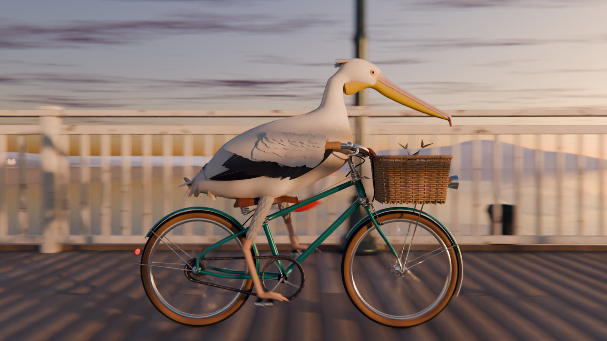
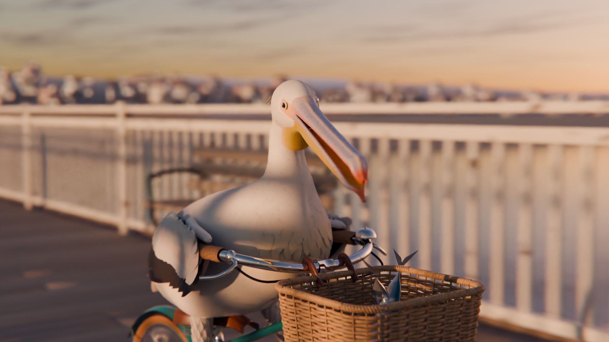
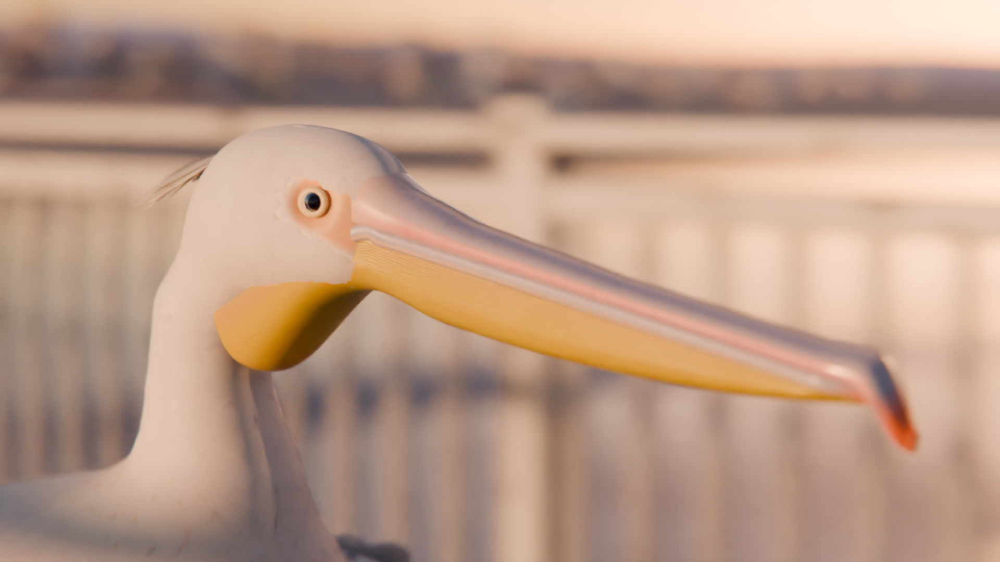

# A Pelican Riding a Bicycle

A 20-second, path-traced short film: a great white pelican pedals a vintage
shopper bicycle down a wooden pier at golden hour, past a "NO CYCLING" sign,
into the sunset.

Everything is built procedurally in Python inside Blender 4.5 LTS. There are
no downloaded assets, textures or models; every mesh, material, animation curve
and sound is generated by the code in this folder.

## The film

**[Watch it: film/pelican_riding_a_bicycle.mp4](film/pelican_riding_a_bicycle.mp4)** (1920×1080, 24 fps, 20 s, with sound)

| | |
|---|---|
|  |  |
|  |  |
|  | |

| shot | time | what happens |
|------|------|--------------|
| 1. Approach | 0–4 s | 105 mm telephoto, low on the deck. The pelican rides toward camera past the sign. |
| 2. Side track | 4–8 s | Tracking alongside the drive side: chain, spokes and feet on the pedals; the camera drifts up to the rider. |
| 3. Front ¾ | 8–12 s | The bird stops pedalling (pedals parked level, freewheel ticking), turns to eye the camera and opens its bill. |
| 4. Close-up | 12–16 s | Warm key light on the head, eye, bill and gular pouch against bokeh; it glances back at the lens. |
| 5. Sunset | 16–20 s | It rides off down the pier into the sun while pelicans glide past on the horizon. |

## What is modelled

**Bicycle** (`pb/bicycle.py`)
- Lugged steel frame with chrome lugs and gold pinstripes, a raked fork and a head badge.
- 20" wheels with double-wall rim profiles, gum-wall tyres with procedural chevron tread, and flanged hubs.
- 32 spokes per wheel, laced 3-cross, with J-bend heads and nipples.
- 44T chainring and 22T cog with real tooth profiles. The chain is about 90 links of alternating inner and outer plates, rollers and pins, driven along the true tangent path by Geometry Nodes.
- Sprung leather saddle with coil springs and copper rivets, North Road bars with cork grips, and side-pull brakes with cable housings.
- Bell, bullet headlamp, fenders with stays and a rear reflector.
- Hand-woven wicker basket (stakes, over-under weavers, braided rim) holding three iridescent mackerel.

**Pelican** (`pb/pelican_body.py`, `pelican_parts.py`, `feathers.py`, `rig.py`)
- Body, neck and head are a signed distance field (smooth-unioned ellipsoids and a tapered S-curve neck), polygonised with marching cubes and Taubin-smoothed.
- Lofted upper mandible with culmen ridge, tomium and hooked nail; lower mandible rami; and a sagging gular pouch with subsurface scattering.
- Eyes with iris, refractive cornea and orbital ring, plus bare facial skin.
- About 2,800 individual feathers:
  - Contour feathers are Poisson-disk distributed over the body, aligned to a head-to-tail flow field, and draped onto offset surfaces of the SDF so they shingle without penetrating.
  - The folded wings are layered panels of primaries, secondaries, tertials and four covert rows, with alula and a feathered leading edge.
  - Also a tail fan, a nape crest and feathered "trousers".
- Totipalmate webbed feet (all four toes webbed) with claws and reticulate scales.
- Rig: torso, five-bone neck, head, jaw, pouch and tail bones. Two-bone IK legs are locked to the pedals, and the feet copy the pedal rotation. Skin weights are computed procedurally; feathers inherit weights from the nearest body vertex.

**Animation** (`pb/anim.py`, `pb/shots.py`)
- The bike kinematics are consistent:
  - Wheel spin equals distance travelled divided by radius.
  - The crank drives the chain and cog through the 2:1 gear ratio.
  - When the bird coasts, the freewheel lets the wheel overrun the cog, and the pedals are parked level.
- The rider bobs and rolls with each pedal stroke, its head is stabilised against body and bike lean, and the bird glances around.
- The pouch jiggles on a damped spring driven by body acceleration.
- Feathers ruffle in a noise field streaming past.

**World** (`pb/environment.py`)
- A 250 m pier: over 3,000 individually warped deck boards, stringers, pile caps, X-bracing, and pilings with wet bands, algae and barnacles.
- Railings with around 3,000 balusters, Victorian cast-iron lamp posts with lanterns, benches, life rings, bollards and the sign.
- An FFT ocean with foam.
- A Nishita sky with a procedural cloud layer lit by the sun and a camera-only sun disc.
- A hazy seaside town with palms, distant hills, a headland with a lighthouse, gulls on looping flight paths and perched on lamps, and a line of gliding pelicans.

**Rendering**: Cycles path tracing at 1920×1080, 24 fps, with:
- true motion blur and depth of field,
- OpenImageDenoise,
- AgX colour management,
- bloom, sun streaks and lens dispersion in the compositor,
- vignette and grain at encode time.

**Sound** (`audio/synth.py`): synthesised with numpy and synced to the animation. It has:
- tyre thumps on every plank seam, computed from the real wheel position,
- chain whir that follows cadence, and freewheel pawl ticks while coasting,
- saddle creaks, bill clacks, the sea and gull calls,
- a Karplus-Strong plucked-string waltz with a glockenspiel melody.

## Reproduce

```bash
# Blender 4.5 LTS; scikit-image + scipy in Blender's Python
BPY=/path/to/blender/4.5/python/bin/python3.11
$BPY -m pip install scikit-image scipy

blender -b -P pelican/build.py -- --out scene.blend              # ~1 min
blender -b scene.blend -P pelican/tools/render_frames.py -- frames --range 1-481 --pct 100
$BPY pelican/audio/synth.py scene_motion.npz soundtrack.wav
pelican/tools/encode.sh frames soundtrack.wav pelican_riding_a_bicycle.mp4
```

Look-development helpers live in `tools/preview_bike.py` and `tools/preview_rider.py`.
